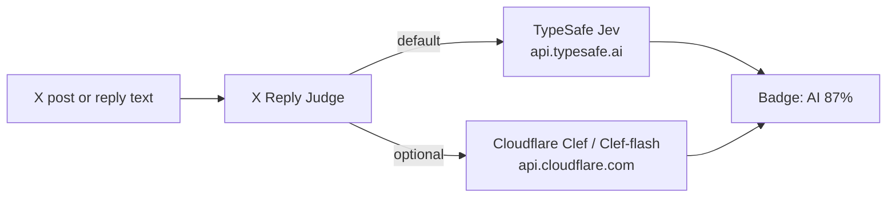

# X Reply Judge

[简体中文](README.zh-CN.md)

Chrome MV3 extension that adds one small badge to each post or reply on X (Twitter): `AI 87%`.
Colors: **≥ 45 red**, **20–44 orange**, **0–19 gray**. Hover the badge for the signals that fired.

The default backend is TypeSafe **Jev**. An optional backend calls Cloudflare Workers AI **Clef** or **Clef-flash**.
Both are decision models. The default judge mode sends 13 yes/no questions in one request and combines them.
Single-question mode is still available.

Also adds **Mute** / **Block** buttons on each reply (post detail / notifications). They act **only when you click them**.



## Source and license

This repository (`dulk-dev/x-reply-judge`) is a public fork of
[liaocaoxuezhe/x-reply-judge-jev](https://github.com/liaocaoxuezhe/x-reply-judge-jev),
which is a modified derivative of
[dontbesilent2025/x-reply-guard](https://github.com/dontbesilent2025/x-reply-guard)
(commit `56bda1b`), Copyright (c) 2026 dontbesilent, MIT License.

x-reply-judge-jev replaced that project's LLM scoring prompt and multi-provider layer with one
TypeSafe Jev call per item, sends only the text, and shows a single probability. DOM scraping
(`data-testid` selectors), the cache / auto-scan flow, and the hide/block logic in
`reply-cleaner.js` come from x-reply-guard. See `LICENSE`.

This fork keeps that behavior, keeps Jev as the default, and adds Cloudflare Clef as an optional
backend. Public changes in this fork are by Chaochun, under the same MIT License.

## How it works

### Pages

| Page | What is scored |
| ---- | -------------- |
| Home feed (`/`, `/home`) and other post streams (explore, search, bookmarks, lists, profiles) | Visible posts (skips your own) |
| Post detail (`/user/status/id`) | Replies under the main post (other accounts) |

### Trigger modes (Options → Scanning)

- **Auto** (default): when you open a feed or a post detail page, newly visible unscored items
  are batched (~2 s) and sent to the API, capped by the daily auto-scan limit.
- **Manual**: no automatic API calls. Already-cached scores still show. Click **Scan posts** /
  **Scan replies** (floating button) or the toolbar icon to analyze.

Manual scan always works in both modes.

### Pipeline

- On a post page, `state` is `原帖：` plus the main post (at most 1000 characters), a blank line, then `回复：` plus the reply.
  A feed post, or a reply whose main post has no text, is `回复：` plus that text.
  No author, tweet id, or timestamps.
- One request per item, at most N in flight (default 4), at most M items per scan (default 30).
- Results are cached in `chrome.storage.local` for 7 days. The key is
  `v3:<m|s>:<p|r>:<tweet id>`: `m`/`s` is multi or single mode, `p`/`r` is whether parent text was included.
- On pages where auto is off or paused, already-cached scores are shown without calling the API.

Badges, Mute/Block, scanning, caching, and page detection are the same for both backends.

## Backends

Options → **Backend**. Existing installs stay on TypeSafe Jev. The key or token is stored only in
`chrome.storage.local` on this device (not synced).

### TypeSafe Jev (default)

1. Create an API key at [console.typesafe.ai](https://console.typesafe.ai).
2. Extension options → Backend **TypeSafe Jev** → paste the key → **Save** → **Test connection**.

The default request is `POST https://api.typesafe.ai/v1/systemone` with `Authorization: Bearer <key>`
and `{ model: "jev-latest", state, questions }`. Each question is
`{ type: "noul", instructions, criteria }`. `criteria` is `{ true, false }`, both strings.
TypeSafe documents that shape as an optional
[noul criteria](https://docs.typesafe.ai/primitives/noul.md) object, so Jev receives the same questions
as Clef. A noul value is `answers.<key>.noul`.

**Advanced** can change the base URL, path, auth header, model name, and response path.
In single mode it can also change the one question. A host other than `api.typesafe.ai` asks for an
optional host permission when you click **Test connection**. There is no separate Account ID.

### Cloudflare Workers AI (Clef)

1. Copy your **Account ID** from the Cloudflare dashboard. Open Search (or press `Ctrl/Cmd+K`) and
   run **Copy account ID**, or copy it under **Workers & Pages → Account details**.
   Docs: [Find account and zone IDs](https://developers.cloudflare.com/fundamentals/account/find-account-and-zone-ids/).
   This extension does not accept a custom base URL. The id is placed only in the request path.
   Spaces and line breaks in the pasted id are removed.
2. Create an API token with only **Workers AI Read**:
   [API Tokens](https://dash.cloudflare.com/profile/api-tokens) → **Create Token** → **Create Custom Token**.
   Permission: **Account → Workers AI → Read**. Include the account you will call.
   Docs for the REST call: [Workers AI REST API](https://developers.cloudflare.com/workers-ai/get-started/rest-api/).
   The dashboard shortcut “Create a Workers AI API Token” can also add **Workers AI Edit**. This
   extension only needs **Read** to run a model.
3. Extension options → Backend **Cloudflare Workers AI (Clef)** → paste the Account ID and token,
   choose **clef-flash** (default) or **clef** → **Save**.
   Saving asks for the optional host permission `https://api.cloudflare.com/*`.
   Then click **Test connection**.

Request (no custom base URL, path, or auth scheme):

`POST https://api.cloudflare.com/client/v4/accounts/{ACCOUNT_ID}/ai/run/@cf/cloudflare/{model}`

- Header: `Authorization: Bearer <token>`, `Content-Type: application/json`
- Body, same shape as Jev: `{ model, state, questions }`. `model` is `clef` or `clef-flash`, never `jev-latest`.
- Each noul value: `result.answers.<key>.noul` (a bare `answers.<key>.noul` is also accepted).

The Account ID and token are not written into extension error text. A failure shows the HTTP status
plus `errors[0].message` and `errors[0].code` only. HTTP 200 with `"success": false` is a failure.
`429` and `5xx` are retried with backoff. No Cloudflare rate-limit header was observed; if a
`retry-after` header is present it is still honored.

Base URL, path, auth header, auth scheme, the Jev model name, and the response-path field are hidden
for this backend. In single mode the question key, instructions, and yes/no criteria stay editable and
are sent to both backends. Leave a box blank to keep that field’s default. A saved copy of the previous
English question, or of the 0.3.1 criteria, is treated as untouched and upgraded. Multi mode does not
use those boxes; Advanced shows the 13 questions instead, so the section is not empty.

### clef and clef-flash

Both are Cloudflare decision models on the same System One-style API. This extension sends text only.

| | clef-flash (default) | clef |
| --- | --- | --- |
| Model id | `@cf/cloudflare/clef-flash` | `@cf/cloudflare/clef` |
| Size | 9B | 27B |
| Context | 24,576 tokens | 65,536 tokens |
| Price | $0.038 per million input tokens | $0.24 per million input tokens |

Output tokens are not charged. Prices were read from the Cloudflare model pages on 2026-10-20 and can change:
[clef-flash](https://developers.cloudflare.com/workers-ai/models/clef-flash/),
[clef](https://developers.cloudflare.com/workers-ai/models/clef/).
`clef-omni` is not offered here.

## Why the default question has criteria

A yes/no question with no rubric barely moved on obvious AI replies. Three Chinese replies that read
as generated “营业式” comments scored **6%**, **11%**, and **13%** in the extension. Replaying the
same English question on Clef, without criteria, stayed in the **5–16%** range. On Clef, with the
narrower 0.3.1 criteria and no parent text, those same three replies scored **83–94%**. Three
human-sounding controls scored **2–39%**.

Single mode still asks one Chinese noul question, now with a broader rubric: restating the post,
polished sentences, the “verdict, then unpack, then outlook” shape, a neutral commentator voice,
versus a short reaction, a personal detail, a direct correction, or messy typing. The six scores
above were measured with the narrower 0.3.1 rubric, on Clef, before parent text was included.
They are an example, not a benchmark, and they are not the multi-signal score.

The rubric is tuned for **Chinese 营业式 replies** and can misread other writing: a careful human
reply, a short agreement, or a translation. The wording is this project's choice.

## Multi-signal judge

Options → **判定方式**. **Multi-signal** is the default. **Single question** is the previous mode.

Multi mode sends 13 noul questions in one request. Nine are AI signals and four are human traits.
Each question’s instructions are a short prefix plus that signal’s text: the parent prefix when the
main post is included, otherwise the no-parent prefix. The score is `clamp(Σ weight × probability, 0, 100)`,
where probability is that question’s noul (0–1):

| Signals | Weight |
| --- | --- |
| r1_generic 万能回复 | +35 |
| r2_restate 复述原帖, r9_commentator 点评员腔 | +30 each |
| r3_structure 结构过整, r4_flip 不是…而是, r5_elevate 金句拔高, r6_engage 求互动, r7_cliche 套话腔 | +15 each |
| r8_bless 祝福吹捧/emoji | +7 |
| h1_experience 亲身经历 | −30 |
| h3_challenge 具体追问/质疑 | −25 |
| h4_joke 玩笑/情绪 | −20 |
| h2_rough 口语毛边 | −15 |

Colors are gray **0–19**, orange **20–44**, red **≥ 45**. The badge tooltip lists signals whose
yes-probability is at least 50%, with the rounded contribution. If any of the 13 answers is missing,
that item gets no score and is not cached.

The questions are fixed. Advanced shows them read-only (key, instructions, yes/no criteria, weight,
AI or human) from the same constant the request uses. Switching back to single mode shows the
editable question again.

## Privacy

- The request body contains the post or reply **text**, the parent post text when the main post is
  on the page, and the questions. It does not contain the author, tweet id, or timestamps.
- The API key or Cloudflare token stays in `chrome.storage.local` on this device. It is not synced and
  is not sent anywhere except the selected API, in the `Authorization` header.
- TypeSafe requests go to the configured host, `https://api.typesafe.ai` unless you change **Advanced**.
- Cloudflare requests go only to `https://api.cloudflare.com`. The Account ID is a path segment on that
  host (`/accounts/{id}/ai/run/...`). It is not copied into logs or error text.
- Scores are cached locally for 7 days under `v3:<m|s>:<p|r>:<tweet id>`.

## Permissions

| Permission | Why |
| --- | --- |
| `storage` | Settings, the key/token, the score cache, and the daily auto-scan counter |
| `activeTab`, `scripting` | Toolbar icon can scan the current X tab |
| `https://api.typesafe.ai/*` | Default backend, granted at install |
| `https://api.cloudflare.com/*` (optional) | Asked when you **Save** with Cloudflare selected |
| `https://*/*`, `http://localhost/*`, `http://127.0.0.1/*` (optional) | A custom TypeSafe host, asked on **Test connection** |
| `https://x.com/*`, `https://twitter.com/*` | Content script that reads the page and draws badges |

## What is verified, and what is not

### TypeSafe Jev

Verified from the official docs (opened 2026-10-20):

- [system-one.md](https://docs.typesafe.ai/api/system-one.md): `POST https://api.typesafe.ai/v1/systemone`,
  `Authorization: Bearer <API_KEY>`, body `{ model, state, questions: { <name>: { type: "noul", instructions } } }`,
  response `{ model, answers: { <name>: { type: "noul", noul: 0.98 } }, usage }`.
- [noul](https://docs.typesafe.ai/primitives/noul.md): `noul` is the probability (0–1) that the answer is yes.
  Optional `criteria.true` / `criteria.false` strings say what a yes and a no mean. This extension
  sends those strings to Jev. The score comparison below was measured on Clef, not re-run on Jev.
- [models](https://docs.typesafe.ai/models.md): `jev-latest` (alias of `jev-1.13.0`), pricing, context, and
  `429` with an optional `retry-after`.
- [errors](https://docs.typesafe.ai/api/errors.md): 400/401/413/415/422/429/529; retry 429/529 with backoff.

The name “TypeSage” shows up in some requests; the docs are for **TypeSafe** (typesafe.ai).

### Cloudflare Clef

Verified from Cloudflare docs (opened 2026-10-20) and from a live Workers AI call on **2026-10-16**:

- Run URL, Bearer token, and body `{ model, state, questions }` match the
  [clef](https://developers.cloudflare.com/workers-ai/models/clef/) and
  [clef-flash](https://developers.cloudflare.com/workers-ai/models/clef-flash/) pages.
  `model` must be `clef` or `clef-flash`.
- A successful body is wrapped: `result.answers.<key>.noul`, plus `success: true`.
  The 2026-10-16 call returned `noul: 0.9685` for clef-flash, with `usage.input_tokens` / `output_tokens`.
- A bad token returned HTTP 401: `success: false`, `errors[0]` = `{ code: 10000, message: "Authentication error" }`.
- A body without `questions` returned HTTP 400: `success: false`, `errors[0].code` 5006, message starting
  `AiError: Bad input:`.
- HTTP 200 with `success: false` is treated as failure.
- That call did not show a rate-limit header. This extension still retries 429 and 5xx.
- [AI Gateway REST API](https://developers.cloudflare.com/ai-gateway/usage/rest-api/) documents
  **Account → Workers AI → Read** as the permission that can call `/accounts/{account_id}/ai/*`.

### Not verified

- **Neither model has an official “AI-text detector” benchmark.** Jev and Clef are general decision models.
  Multi mode combines 13 project-written noul questions. Single mode asks whether a reply is an
  AI-written “营业式” comment. The wording, the question keys, and reading the weighted sum as an
  “AI” score are **this project's choices**. Accuracy is not a claim from TypeSafe or Cloudflare.
  The six-reply comparison above is an illustration of an older single-question rubric.
- This repository’s tests use **mocked** responses in the shape above. No real key or Account ID is in the
  repo, and the tests do not call the network.
- Third-party “Jev detector” sites are not official and are not used.
- `clef-omni` (audio/video) is out of scope.

## Install

1. Clone or unzip this folder.
2. Chrome → `chrome://extensions` → enable **Developer mode** → **Load unpacked** → select the folder.
3. Open **Options**. For Jev, paste a TypeSafe key. For Clef, paste an Account ID and a Workers AI Read token.
4. **Save**, then **Test connection**.
5. Open `x.com/home` or any post. In Auto mode scoring starts on its own; otherwise click **Scan posts** / **Scan replies**.

## Development

```
npm run check   # node --check on every script + manifest JSON parse
npm test        # API parsing/retry/concurrency, settings migration, page-detect; mocked fetch
```

No dependencies. Tests do not need a key or an Account ID.

## Limitations

- X's DOM changes often; the `data-testid` selectors and localized menu labels may break.
- Very short texts give the model little to judge. Treat the badge as a hint, not proof.
- Jev and Clef are calibrated for decision tasks, not specifically for AI-text detection.
- Requests run from the browser with your key. Anyone with access to this Chrome profile can read it.
- Auto mode on a busy feed can consume the daily limit quickly. Lower the limit or switch to Manual.
- Cloudflare bills the account that owns the token. `clef` costs more per input token than `clef-flash`.
- A Cloudflare Account ID has to be in the URL. The extension avoids copying it into errors; the network
  stack and Cloudflare still see it, because that is how the API is addressed.
