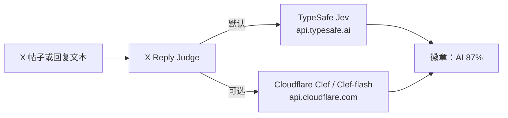

# X Reply Judge

[English](README.md)

Chrome MV3 扩展。在 X（Twitter）的帖子或回复上显示一枚小徽章：`AI 87%`，表示这段文字被判定为 AI 所写的概率。
颜色：**>= 70 红色**，**>= 31 橙色**，其余灰色。不显示理由，也不显示信号列表。

默认后端是 TypeSafe **Jev**。可选后端调用 Cloudflare Workers AI 的 **Clef** 或 **Clef-flash**。
两者都是决策模型：本扩展只问一个是/否问题，并把返回的概率显示出来。

每条回复上还有 **Mute** / **Block** 按钮（帖子详情 / 通知）。**只有你点击时才会执行。**



## 来源与许可

本仓库（`dulk-dev/x-reply-judge`）是
[liaocaoxuezhe/x-reply-judge-jev](https://github.com/liaocaoxuezhe/x-reply-judge-jev)
的公开 fork。后者又衍生自
[dontbesilent2025/x-reply-guard](https://github.com/dontbesilent2025/x-reply-guard)
（commit `56bda1b`），Copyright (c) 2026 dontbesilent，MIT License。

x-reply-judge-jev 把上游的 LLM 打分提示词和多提供商层换成了每条内容一次 TypeSafe Jev 调用，只发送文本，并只显示一个概率。
DOM 抓取（`data-testid` 选择器）、缓存 / 自动扫描流程，以及 `reply-cleaner.js` 里的隐藏 / 拉黑逻辑来自 x-reply-guard。见 `LICENSE`。

本 fork 保留上述行为，默认后端仍是 Jev，并增加可选的 Cloudflare Clef 后端。本 fork 的公开改动由 Chaochun 以同一 MIT 许可发布。

## 如何工作

### 页面

| 页面 | 打分对象 |
| ---- | -------- |
| 主页信息流（`/`、`/home`）以及其他帖子流（探索、搜索、书签、列表、个人主页） | 可见帖子（跳过你自己的） |
| 帖子详情（`/user/status/id`） | 主帖下面、其他账号的回复 |

### 触发方式（选项 → Scanning）

- **Auto**（默认）：打开信息流或帖子详情时，新出现且尚未打分的内容会攒一批（约 2 秒）再请求 API，并受每日自动扫描上限约束。
- **Manual**：不自动请求 API。已经缓存的分数仍会显示。点击 **Scan posts** / **Scan replies**（浮动按钮）或工具栏图标才会分析。

两种模式下都可以手动扫描。

### 流水线

- 发给 API 的 `state` **只有文本**。不含作者、推文 id、时间戳或原帖。推文 id 只在本地当作缓存键。
- 每条内容一次请求，同时在途最多 N 个（默认 4），每次扫描最多 M 条（默认 30）。
- 结果按推文 id 缓存在 `chrome.storage.local`，保留 7 天。
- 自动扫描关闭或暂停时，只显示已缓存的分数，不再请求 API。

徽章、Mute/Block、扫描、缓存和页面判断对两种后端相同。

## 后端

在选项页选择 **Backend**。已有安装升级后仍使用 TypeSafe Jev。密钥或 token 只存在本机的 `chrome.storage.local`（不同步）。

### TypeSafe Jev（默认）

1. 在 [console.typesafe.ai](https://console.typesafe.ai) 创建 API key。
2. 扩展选项 → Backend 选 **TypeSafe Jev** → 粘贴 key → **Save** → **Test connection**。

默认请求是 `POST https://api.typesafe.ai/v1/systemone`，头为 `Authorization: Bearer <key>`，
正文为 `{ model: "jev-latest", state, questions: { ai_generated: { type: "noul", instructions, criteria } } }`。
`criteria` 是 `{ true, false }`，两边都是字符串。TypeSafe 把这个形状写成可选的
[noul criteria](https://docs.typesafe.ai/primitives/noul.md)，所以 Jev 和 Clef 收到同一道题。
分数取 `answers.<key>.noul`。

**Advanced** 可以改 Base URL、path、认证头、模型名、问题 key、响应字段路径和问题原文。
主机不是 `api.typesafe.ai` 时，点击 **Test connection** 会请求可选的主机权限。这里没有单独的 Account ID。

### Cloudflare Workers AI（Clef）

1. 从 Cloudflare 控制台复制 **Account ID**。打开搜索（或按 `Ctrl/Cmd+K`），运行 **Copy account ID**；
   也可以在 **Workers & Pages → Account details** 里复制。
   文档：[Find account and zone IDs](https://developers.cloudflare.com/fundamentals/account/find-account-and-zone-ids/)。
   本扩展不允许自定义 Base URL。Account ID 只放进请求路径。粘贴内容里的空格和换行会被去掉。
2. 创建只含 **Workers AI Read** 的 API token：
   打开 [API Tokens](https://dash.cloudflare.com/profile/api-tokens) → **Create Token** → **Create Custom Token**。
   权限选 **Account → Workers AI → Read**，并包含你要调用的账号。
   REST 调用说明：[Workers AI REST API](https://developers.cloudflare.com/workers-ai/get-started/rest-api/)。
   控制台上的 “Create a Workers AI API Token” 快捷方式可能同时带上 **Workers AI Edit**。本扩展运行模型只需要 **Read**。
3. 扩展选项 → Backend 选 **Cloudflare Workers AI (Clef)** → 粘贴 Account ID 和 token，
   选择 **clef-flash**（默认）或 **clef** → **Save**。
   保存时会申请可选主机权限 `https://api.cloudflare.com/*`。
   然后点击 **Test connection**。

请求（不能改 Base URL、path 或认证方案）：

`POST https://api.cloudflare.com/client/v4/accounts/{ACCOUNT_ID}/ai/run/@cf/cloudflare/{model}`

- 头：`Authorization: Bearer <token>`，`Content-Type: application/json`
- 正文与 Jev 同形：`{ model, state, questions }`。`model` 只能是 `clef` 或 `clef-flash`，不会是 `jev-latest`。
- 分数：`result.answers.<key>.noul`（若响应只有顶层 `answers.<key>.noul` 也能解析）。

Account ID 和 token 不会写进扩展的错误文本。失败时只显示 HTTP 状态码，以及 `errors[0].message` 和 `errors[0].code`。
HTTP 200 且 `"success": false` 也算失败。`429` 和 `5xx` 会按退避重试。实测没有看到 Cloudflare 的限流响应头；
如果响应里有 `retry-after`，仍然会遵守。

选择该后端时，Base URL、path、认证头、认证方案、Jev 模型名和响应字段路径会隐藏。
问题 key、问题说明和“是/否” criteria 仍然可编辑，并且两种后端都会发送。某一栏留空就用该栏的默认值。
已经保存过的旧英文默认问法、且没有 criteria 时，视为没有自定义过，会自动换成现在的默认问题。

### clef 与 clef-flash

两者都是 Cloudflare 的决策模型，使用同一套 System One 风格的 API。本扩展只发送文本。

| | clef-flash（默认） | clef |
| --- | --- | --- |
| 模型 id | `@cf/cloudflare/clef-flash` | `@cf/cloudflare/clef` |
| 规模 | 9B | 27B |
| 上下文 | 24,576 tokens | 65,536 tokens |
| 价格 | 每百万 input tokens $0.038 | 每百万 input tokens $0.24 |

不按 output tokens 计费。价格取自 2026-10-20 的 Cloudflare 模型页，之后可能变化：
[clef-flash](https://developers.cloudflare.com/workers-ai/models/clef-flash/)、
[clef](https://developers.cloudflare.com/workers-ai/models/clef/)。
这里不提供 `clef-omni`。

## 为什么默认问题要带 criteria

没有评分标准的是/否问题，对明显的 AI 回复几乎不动。三条读起来就是生成的中文“营业式”回复，在扩展里只有 **6%**、**11%**、**13%**。把同一句英文、不带 criteria 的问法拿到 Clef 上重放，分数停在 **5–16%**。

现在的默认是一道中文 noul 问题，加上 `criteria.true` / `criteria.false`：一边是复述原帖、结构整齐、泛泛地补一句“要是…就更好了”；另一边是像真人随手打的。在 Clef 上，同样这三条是 **83–94%**。三条真人口吻的对照是 **2–39%**。

这只是 **六条回复**，用来举例，不是基准。这组 criteria 是按**中文营业式回复**调的，别的写法可能会误判：写得很整齐的真人回复、很短的附和，或者译文。措辞是本项目自己的选择。`state` 仍然只有回复正文。评分标准里提到“原帖”，指的是一种文风；请求里不会附上父帖，模型也不能真的拿回复和原帖对照。

## 隐私

- 请求正文包含帖子或回复的**文本**以及问题。不含作者、推文 id、时间戳或父帖。
- API key 或 Cloudflare token 只存在本机 `chrome.storage.local`。不会同步，也不会发到所选 API 以外的地方；发送时只放在 `Authorization` 头里。
- TypeSafe 请求发往所配置的主机，默认是 `https://api.typesafe.ai`，除非你在 **Advanced** 里修改。
- Cloudflare 请求只发往 `https://api.cloudflare.com`。Account ID 是该主机上的路径段（`/accounts/{id}/ai/run/...`）。它不会被复制到日志或错误文本里。
- 分数在本地缓存 7 天，键是推文 id。

## 权限

| 权限 | 原因 |
| --- | --- |
| `storage` | 设置、key/token、分数缓存、每日自动扫描计数 |
| `activeTab`、`scripting` | 工具栏图标扫描当前 X 标签页 |
| `https://api.typesafe.ai/*` | 默认后端，安装时授予 |
| `https://api.cloudflare.com/*`（可选） | 选择 Cloudflare 并 **Save** 时询问 |
| `https://*/*`、`http://localhost/*`、`http://127.0.0.1/*`（可选） | 自定义 TypeSafe 主机，在 **Test connection** 时询问 |
| `https://x.com/*`、`https://twitter.com/*` | 读取页面并绘制徽章的内容脚本 |

## 已验证与未验证

### TypeSafe Jev

以下内容对照官方文档（2026-10-20 打开）：

- [system-one.md](https://docs.typesafe.ai/api/system-one.md)：`POST https://api.typesafe.ai/v1/systemone`，
  `Authorization: Bearer <API_KEY>`，正文 `{ model, state, questions: { <name>: { type: "noul", instructions } } }`，
  响应 `{ model, answers: { <name>: { type: "noul", noul: 0.98 } }, usage }`。
- [noul](https://docs.typesafe.ai/primitives/noul.md)：`noul` 是回答为“是”的概率（0–1）。
  可选的 `criteria.true` / `criteria.false` 字符串用来说明什么算“是”、什么算“否”。本扩展会把这两段字符串发给 Jev。下面的分数对比是在 Clef 上测的，没有用 Jev 再跑一遍。
- [models](https://docs.typesafe.ai/models.md)：`jev-latest`（`jev-1.13.0` 的别名）、价格、上下文，以及带可选 `retry-after` 的 `429`。
- [errors](https://docs.typesafe.ai/api/errors.md)：400/401/413/415/422/429/529；对 429/529 做退避重试。

有些说法写成 “TypeSage”；文档对应的是 **TypeSafe**（typesafe.ai）。

### Cloudflare Clef

对照 Cloudflare 文档（2026-10-20 打开），以及 **2026-10-16** 的一次真实 Workers AI 调用：

- 运行 URL、Bearer token、正文 `{ model, state, questions }` 与
  [clef](https://developers.cloudflare.com/workers-ai/models/clef/) 和
  [clef-flash](https://developers.cloudflare.com/workers-ai/models/clef-flash/) 页面一致。
  `model` 只能是 `clef` 或 `clef-flash`。
- 成功响应多包一层：`result.answers.<key>.noul`，并且 `success: true`。
  2026-10-16 那次调用里，clef-flash 返回 `noul: 0.9685`，并带有 `usage.input_tokens` / `output_tokens`。
- 错误 token 返回 HTTP 401：`success: false`，`errors[0]` 为 `{ code: 10000, message: "Authentication error" }`。
- 缺少 `questions` 的正文返回 HTTP 400：`success: false`，`errors[0].code` 为 5006，message 以 `AiError: Bad input:` 开头。
- HTTP 200 且 `success: false` 视为失败。
- 那次调用没有看到限流响应头。本扩展仍然会重试 429 和 5xx。
- [AI Gateway REST API](https://developers.cloudflare.com/ai-gateway/usage/rest-api/) 写明：
  调用 `/accounts/{account_id}/ai/*` 需要 **Account → Workers AI → Read**。

### 未验证

- **两个模型都没有官方的“AI 文本检测”基准。** Jev 和 Clef 都是通用决策模型。默认问题问的是这条回复是不是 AI 写的“营业式”评论，并用 true/false criteria 描述这种文风。
  措辞、问题 key `ai_generated`，以及把 `noul` 当成“AI 概率”，都是**本项目自己的选择**。
  TypeSafe 和 Cloudflare 都没有为此给出准确率承诺。上面六条回复的对比只是示例。
- 本仓库的测试使用上述形状的 **mock** 响应。仓库里没有真实 key 或 Account ID，测试也不会访问网络。
- 第三方 “Jev detector” 网站不是官方接口，本项目不使用。
- `clef-omni`（音频 / 视频）不在范围内。

## 安装

1. 克隆或解压本目录。
2. Chrome → `chrome://extensions` → 打开 **开发者模式** → **加载已解压的扩展程序** → 选择本目录。
3. 打开 **选项**。用 Jev 时粘贴 TypeSafe key。用 Clef 时粘贴 Account ID 和只含 Workers AI Read 的 token。
4. **Save**，然后 **Test connection**。
5. 打开 `x.com/home` 或任意帖子。Auto 模式下会自己开始打分；否则点击 **Scan posts** / **Scan replies**。

## 开发

```
npm run check   # 对每个脚本做 node --check，并解析 manifest JSON
npm test        # API 解析/重试/并发、设置迁移、页面判断；fetch 均为 mock
```

零依赖。测试不需要 key 或 Account ID。

## 限制

- X 的 DOM 经常变；`data-testid` 选择器和本地化菜单文案可能会失效。
- 文本很短时，模型几乎没有可判断的内容。徽章只是提示，不是证据。
- Jev 和 Clef 针对的是决策任务，不是专门的 AI 文本检测。
- 请求从浏览器发出，并带上你的密钥。能打开这个 Chrome 配置文件的人都能读到它。
- 忙碌的信息流上，Auto 模式会很快用完每日上限。可以调低上限，或改成 Manual。
- Cloudflare 会向 token 所属账号计费。按 input token 计算，`clef` 比 `clef-flash` 更贵。
- Cloudflare 的 Account ID 必须出现在 URL 里。扩展避免把它复制进错误文本；网络栈和 Cloudflare 仍然会看到它，因为 API 就是这样寻址的。
